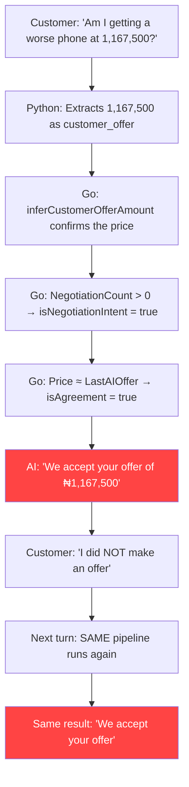
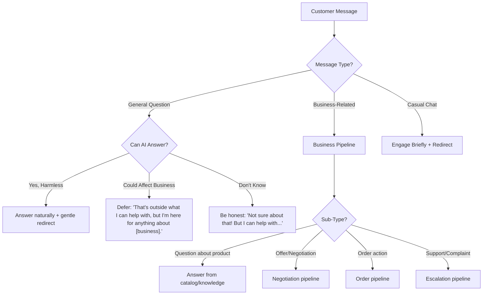
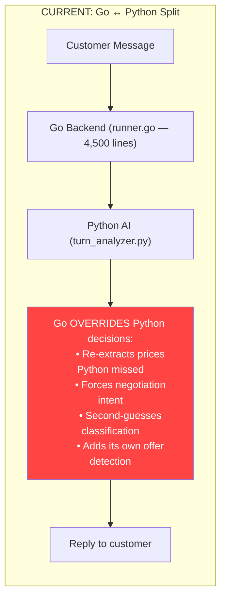
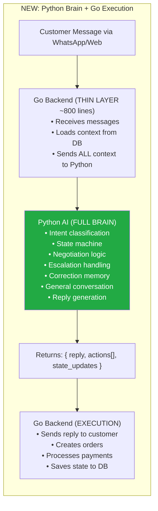
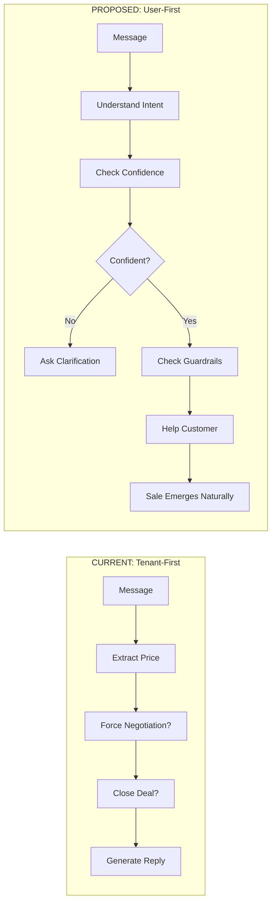
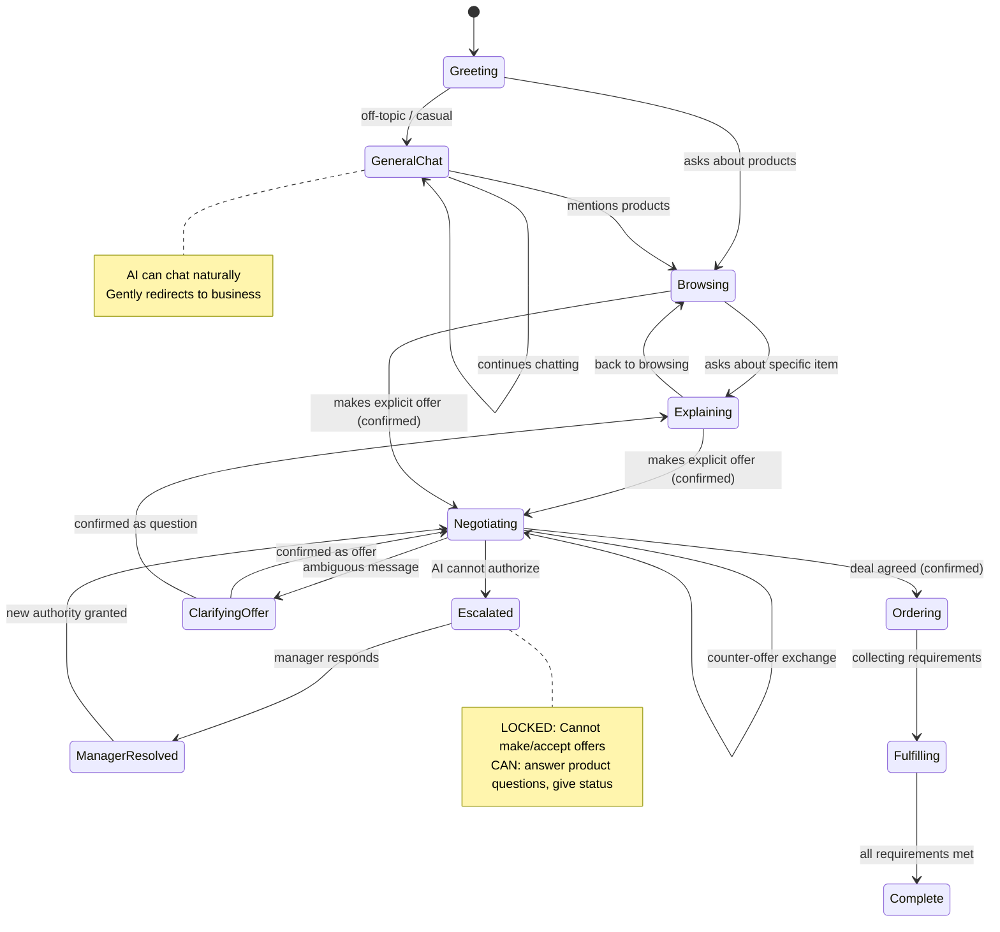
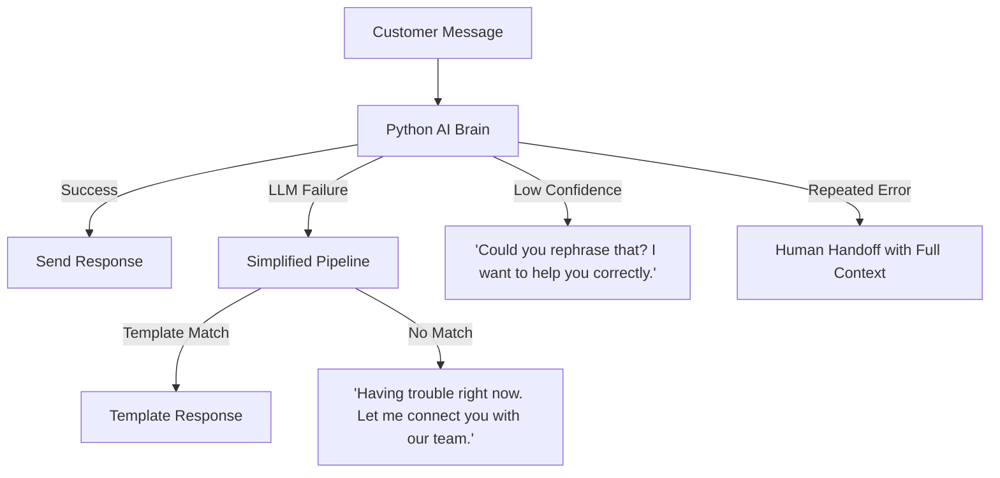

# Brancr AI — User-First Architecture: Deep Research Report

> **Core Thesis:** The Brancr AI is designed tenant-first — every decision point optimizes for "how do I move this toward a sale." Flipping to user-first — "what does this customer actually need right now?" — fixes the root cause of every observed bug and makes the AI production-ready.

---

## 1. The Tenant-First Problem: A Full Audit

### 1.1 How Every Decision Point Is Biased Toward the Tenant

I audited the entire AI pipeline through a user-first lens. Here's every place the code chose the tenant's interest over the customer's:

| Code Location | What It Does | Tenant-First Bias | User-First Alternative |
|---|---|---|---|
| [inferCustomerOfferAmount](file:///c:/Users/USER/Desktop/Brancr%20Project/Brancr/internal/ai_v4/runner/runner.go#L570-L598) | Extracts ANY price from ANY message | "A number appeared → maybe we can close!" | "Why did they mention this number? Question? Comparison? Offer?" |
| [Negotiation fallback L3386-3404](file:///c:/Users/USER/Desktop/Brancr%20Project/Brancr/internal/ai_v4/runner/runner.go#L3386-L3404) | If `NegotiationCount > 0`, forces `isNegotiationIntent = true` | "Don't let them leave the negotiation!" | "They're in negotiation context, but listen to what they're actually saying" |
| [customerAcceptsLastOffer L520-547](file:///c:/Users/USER/Desktop/Brancr%20Project/Brancr/internal/ai_v4/runner/runner.go#L520-L547) | Matches "ok", "sure", "deal" as acceptance | "Quick, close before they change their mind!" | "Did they agree to buy, or just acknowledge?" |
| [Go offer inference L3111-3123](file:///c:/Users/USER/Desktop/Brancr%20Project/Brancr/internal/ai_v4/runner/runner.go#L3111-L3123) | If Python missed a price, Go extracts it AND forces `negotiation_offer` intent | "Python missed a sale opportunity, Go catches it" | "If Python didn't detect an offer, maybe it's genuinely not one" |
| [Buying confidence L730-734](file:///c:/Users/USER/Desktop/Brancr%20Project/brancr-ai/api/turn_analyzer.py#L730-L734) in unified prompt | LLM rates "buying readiness" on every message | "How close is this person to purchasing?" | "What phase of their journey are they in?" |
| [Strategy injection L676-688](file:///c:/Users/USER/Desktop/Brancr%20Project/brancr-ai/api/turn_analyzer.py#L676-L688) | Injects "DEFEND PRICE", "SMALL DROP", "NEGOTIATE" | "What's our sales tactic this round?" | "What does the customer need to hear to feel confident?" |
| [Deal acceptance L3194-3248](file:///c:/Users/USER/Desktop/Brancr%20Project/Brancr/internal/ai_v4/runner/runner.go#L3194-L3248) | If customer's price ≈ last AI offer, auto-accepts | "They said our number — close it!" | "Confirm before taking irreversible action" |
| [Intent handling L719-727](file:///c:/Users/USER/Desktop/Brancr%20Project/brancr-ai/api/turn_analyzer.py#L719-L727) in prompt | "If negotiation_offer → empty reply (defer to agent)" | Intent classification drives toward sale categories | Should classify customer *need* first |

### 1.2 The Cascade Effect

These biases compound. Here's what happens when a customer asks "Am I getting a worse phone at 1,167,500?":



> **No single line of code is "wrong."** The problem is that every line makes the same assumption: *this customer is probably trying to buy something.*

### 1.3 What the Conversation Snapshot Tracks vs. What It Should Track

| Currently Tracked | Missing (User-First) |
|---|---|
| `LastUserMessage` | `CustomerFrustrationLevel` |
| `LastAIReply` | `CorrectionHistory[]` — what the AI got wrong |
| `LastDomain` | `CustomerJourney` — browsing / researching / deciding / buying |
| `ConversationStage` | `PendingClarification` — what we asked but haven't confirmed |
| `NegotiationRound` | `EscalationState` — locked / pending / resolved |
| `LastOfferedPrice` | `PriceAuditTrail[]` — full history of offers |
| `TurnCount` | `RepeatQuestionCount` — how many times customer repeated |
| `ConversationMode` (general/ordering) | `CustomerSentiment` — emotional state tracking |

---

## 2. General Conversation: The Missing Layer

### 2.1 The Problem

Currently, if a customer says anything not related to products/orders, the pipeline doesn't know what to do. It forces the message through business-intent classification, creating confusion:

| Message Type | Current Behavior | What Should Happen |
|---|---|---|
| "Is it going to rain tomorrow?" | Confused → generic fallback | Answer naturally: "Not sure about that, but happy to help with anything about our products." |
| "What's the best area in Lagos?" | Misclassified → tries to extract intent | Engage briefly, then redirect: "Good question! For deliveries, we cover most areas in Lagos. Anything else I can help with?" |
| Casual banter / small talk | Routed to intent classifier → "I don't understand" | Be human: chat briefly, stay friendly |
| Off-topic but harmless question | Ignored or misclassified | Answer it — builds rapport and trust |
| Questions already covered in business knowledge | Sometimes missed by catalog matching | Answer from FAQ/knowledge base first |

### 2.2 User-First Conversation Routing



### 2.3 Why This Matters

A business that can hold a casual conversation is **more trustworthy** than one that only talks about products. Think about a real shopkeeper — they chat about the weather, ask how your day is, THEN help you find what you need. The AI should do the same.

**Key Principles:**
1. **Don't force every message through business logic** — If it's not business-related, don't try to extract intents, offers, or order items
2. **Be helpful even off-topic** — Answering a harmless question builds rapport
3. **Always be honest about limitations** — "I'm not sure about that" is better than a confused response
4. **Gentle redirects, not hard blocks** — "Happy to help with that! Also, anything else about our products?" vs. "I can only help with orders"

---

## 3. Architecture Redesign: Consolidate AI to Python

### 3.1 The Core Problem With the Current Split



**The root cause of most bugs is this split.** Python says "this is a question" → Go says "but I found a price, so it's an offer" → Go wins → customer gets confused.

### 3.2 The Target Architecture



### 3.3 What Each Layer Handles

**Go Backend (Thin Layer) — keeps what Go is best at:**

| Responsibility | Why Go |
|---|---|
| HTTP server / WhatsApp webhook | High concurrency, low latency |
| Database operations (GORM) | Already built, stable |
| Load conversation context | DB queries are fast in Go |
| Send messages to WhatsApp/Web | API client calls |
| Payment processing | Business-critical, already built |
| File storage / media handling | Already built |

**Python AI (Full Brain) — moves ALL intelligence to one place:**

| Responsibility | Why Python |
|---|---|
| Intent classification | LLM ecosystem, better NLP tools |
| Conversation state machine | Easier to iterate and prototype |
| Negotiation logic & guardrails | Single source of truth for all AI decisions |
| Escalation handling | Integrated with state machine |
| Correction memory | Per-conversation learning |
| General conversation handling | LLM's natural capability |
| Catalog explanation (RAG) | Better RAG tooling in Python |
| Reply generation + style adaptation | Already in Python |
| Frustration detection | Sentiment analysis libraries |

### 3.4 The API Contract Between Go and Python

**Go sends to Python:**

```json
{
    "tenant_id": "uuid",
    "conversation_id": "uuid",
    "message": "Am I getting a worse phone at 1,167,500?",
    "context": {
        "tenant_knowledge": { /* business name, description, catalog */ },
        "conversation_history": [
            { "role": "user", "text": "I'm willing to pay 1,150,000" },
            { "role": "ai", "text": "I cannot accept... I can offer 1,167,500" }
        ],
        "conversation_state": {
            "stage": "negotiating",
            "escalation_state": "none",
            "correction_log": [],
            "last_offered_price": 1167500,
            "customer_journey": "deciding",
            "frustration_level": 0
        },
        "order_state": { /* current order if any */ },
        "active_fulfillment": null
    }
}
```

**Python returns to Go:**

```json
{
    "reply": "At ₦1,167,500, you get the exact same iPhone 14 Pro Max. The lower price is from the negotiation — no difference in the phone itself.",
    "actions": [],
    "state_updates": {
        "stage": "negotiating",
        "correction_log": [],
        "frustration_level": 0,
        "customer_journey": "deciding"
    },
    "debug": {
        "classified_as": "question",
        "confidence": 0.95,
        "guards_applied": ["question_guard", "escalation_check"],
        "price_detected": 1167500,
        "price_treated_as": "reference_not_offer"
    }
}
```

> Go does NOT second-guess Python's decisions. Python is the single source of truth for all AI behavior.

### 3.5 What This Eliminates

| Current Problem | Why It Exists | How Consolidation Fixes It |
|---|---|---|
| Go overrides Python's "this is a question" | Two systems disagree | One system (Python) makes the decision |
| `inferCustomerOfferAmount` in Go re-extracts prices | Go doesn't trust Python | No re-extraction — Python decides if it's an offer |
| Forced negotiation continuation in Go | Go has its own intent logic | Python manages the full state machine |
| Escalation contradictions | Go continues after Python escalated | State machine in Python controls transitions |
| Double classification of intent | Go + Python both classify | Single classification in Python |

### 3.6 Migration Path (Incremental)

You don't rewrite everything at once:

| Phase | What Moves | Go Lines Removed | Risk |
|---|---|---|---|
| **Phase 1** | Move offer detection + question guards to Python. Go stops overriding. | ~200 lines | Low |
| **Phase 2** | Move negotiation logic + escalation to Python | ~500 lines | Medium |
| **Phase 3** | Move state machine + order creation decisions to Python | ~800 lines | Medium |
| **Phase 4** | Move remaining RunTurn logic. Go becomes thin proxy. | ~2000 lines | Higher — do carefully |

> [!TIP]
> After Phase 1 alone, the "question treated as offer" bug disappears because Go stops overriding Python. Each phase independently improves the AI.

---

## 4. The User-First Pipeline

### 4.1 Current Pipeline vs. User-First Pipeline



### 4.2 The Three-Layer Architecture

| Layer | Purpose | When It Runs |
|---|---|---|
| **Layer 1: Understand** | What is the customer saying? What do they need? | Every message |
| **Layer 2: Guard** | Are we sure? Is this safe? Does it contradict what we said? | Before every action |
| **Layer 3: Act** | Respond helpfully; facilitate sale if appropriate | After guards pass |

### 4.3 Layer 1 — Understand (Replace Current Intent Detection)

**User-First Redesign:**

```
STEP 1 — Message Type Classification (BEFORE any price extraction):
  → QUESTION: Contains ?, starts with who/what/why/how/when/which, "am I", "is it", "does that"
  → CORRECTION: "I didn't mean", "that's not what I said", "I was asking", "no, I meant"
  → OBJECTION: "too expensive", "high side" (without an offer)
  → OFFER: "I'll pay", "take X", "my offer is", "deal at"
  → ACCEPTANCE: "ok deal", "I agree", "proceed"
  → BROWSING: "what do you have", "show me", "tell me about"
  → GENERAL: casual chat, off-topic questions, greetings
  → FAREWELL: goodbye, thanks, closing

STEP 2 — Confidence Check:
  → If OFFER + confidence > 85%: Proceed to negotiation
  → If OFFER + confidence 60-85%: Ask "Just to confirm, you'd like to offer ₦X?"
  → If OFFER + confidence < 60%: Treat as question
  → If QUESTION (any confidence): NEVER force into negotiation

STEP 3 — Context Cross-Reference:
  → Was this corrected before? → Don't repeat the mistake
  → Does this contradict what we said? → Acknowledge
  → Is the customer repeating? → They're frustrated
```

### 4.4 Layer 2 — Guard (Multi-Layered Guardrails)

| Guard | What It Checks | Blocks |
|---|---|---|
| **Question Guard** | Is this a question? → Don't extract offer | Question → offer misclassification |
| **Correction Guard** | Did the user correct us before? | Repeating same mistakes |
| **Escalation Lock** | Are we in escalated state? → No price actions | Escalation contradictions |
| **Consistency Guard** | Does our reply contradict previous turn? | Pricing inconsistency |
| **Confidence Gate** | Is classification confidence > threshold? | No clarifying questions |
| **Acceptance Gate** | Does message contain explicit offer language? | Premature acceptance |
| **Frustration Detector** | Is customer repeating / escalating tone? | Triggers empathy |
| **General Chat Guard** | Is this not business-related at all? | Don't force through business pipeline |

### 4.5 Layer 3 — Act (Principled Response Generation)

| Scenario | Current Behavior | User-First Behavior |
|---|---|---|
| Customer asks about a price | "We accept your offer" | "At ₦1,167,500, you get the same iPhone 14 Pro Max." |
| Customer corrects the AI | Apologize → repeat same mistake | "Got it — you were asking, not offering. Let me answer." + store correction |
| Escalation triggered | Continue negotiating anyway | Lock state. Answer product questions only. |
| Customer asks something off-topic | Confused / generic fallback | Answer helpfully, gently redirect |
| Ambiguous message | Force highest-commitment interpretation | "Are you making an offer, or asking about the pricing?" |

---

## 5. Production Readiness

### 5.1 Current vs. Production-Ready

| Area | Current State | Production-Ready | Gap |
|---|---|---|---|
| **Error Recovery** | Panic recovery only | Graceful degradation + fallback | 🔴 Large |
| **State Management** | Ad-hoc snapshot | Formal state machine | 🔴 Large |
| **Observability** | Basic zap logging | Structured traces + metrics | 🟡 Medium |
| **Guardrails** | `looksLikeQuestion` (minimal) | Multi-layered guard pipeline | 🔴 Large |
| **Correction Handling** | None | Per-conversation correction memory | 🔴 Missing |
| **Escalation** | Flag set, not enforced | State machine lock | 🔴 Missing |
| **General Conversation** | Not supported | LLM handles with business redirect | 🔴 Missing |
| **Testing** | One test file | Conversation replay suite | 🟡 Medium |
| **Fallback** | Generic response | Layered: primary → simplified → template → human | 🟡 Medium |

### 5.2 Conversation State Machine



### 5.3 Correction Memory

```
Per-Conversation Correction Log:
    corrections: [
        {
            turn: 5,
            type: "misclassified_question_as_offer",
            original_message: "Am I getting a worse phone at 1,167,500?",
            extracted_price: 1167500,
            user_correction: "I've not made an offer, I simply asked a question",
            lesson: "Price 1167500 in question context = NOT an offer"
        }
    ]

Before classifying → Check if correction applies
Before accepting  → Check if price was previously corrected
Before repeating  → Check if pattern was corrected
```

### 5.4 Monitoring Metrics

| Metric | Alert Threshold |
|---|---|
| `ai.correction_rate` — customer corrects AI | > 5% |
| `ai.repeat_question_rate` — customer repeats question | > 10% |
| `ai.escalation_contradiction_rate` — prices after escalation | > 0% |
| `ai.false_acceptance_rate` — "accepted" but no offer | Track & review |
| `ai.clarification_asked_rate` — AI asked for clarity | Target: 5-15% |
| `ai.general_chat_handled_rate` — off-topic handled gracefully | > 90% |
| `ai.question_misclass_rate` — questions classified as offers | > 2% |

### 5.5 Fallback Strategy



---

## 6. Implementation Roadmap

### Phase 1: Stop the Bleeding (Immediate — in current Go code)

| Change | Impact |
|---|---|
| Add question guard to `inferCustomerOfferAmount` | Stops question → offer |
| Stop forced negotiation continuation at L3386 | Stops forced intent override |
| Add question guard to Go offer inference L3111 | Stops Go second-guessing Python |
| Expand `looksLikeQuestion` patterns | Better question detection |

### Phase 2: Start Python Migration

| Change | Impact |
|---|---|
| Move offer detection logic to Python | Single source of truth |
| Add general conversation handling in Python | AI can chat naturally |
| Add correction memory to Python | AI learns from mistakes |
| Go stops overriding Python's intent classification | Eliminates root cause of double-classification |

### Phase 3: Full Python Brain

| Change | Impact |
|---|---|
| Migrate negotiation engine to Python | Complete control in one place |
| Implement conversation state machine in Python | Formal state transitions |
| Migrate escalation logic to Python | State lock enforcement |
| Add multi-layered guardrail pipeline in Python | User-first guards |

### Phase 4: Production Hardening

| Change | Impact |
|---|---|
| Add observability metrics | Monitor AI quality |
| Layered fallback system | Graceful degradation |
| Conversation replay test suite | Regression prevention |
| Output contradiction guard | Self-consistency |

---

## 7. Impact Summary

| Metric | Tenant-First (Current) | User-First (Proposed) |
|---|---|---|
| **False offer acceptance** | High (observed in chats) | Zero (question guard + confirmation) |
| **Customer trust** | Eroding (corrects AI 3+ times) | Building (AI understands and confirms) |
| **General conversation** | Broken (force-classifies everything) | Natural (handles casual chat) |
| **Codebase complexity** | 4,500 lines Go + 1,800 lines Python (overlapping) | ~800 lines Go + unified Python brain |
| **Iteration speed** | Slow (change Go + Python + redeploy both) | Fast (change Python only for AI behavior) |
| **Conversion quality** | Low ("I didn't mean to buy") | High (confirmed, intentional purchases) |
| **Brand perception** | "Pushy bot" | "Helpful assistant that listens" |

> **The irony:** A user-first AI converts *better* than a tenant-first AI because customers who feel understood buy more confidently, return more often, and refer others.
